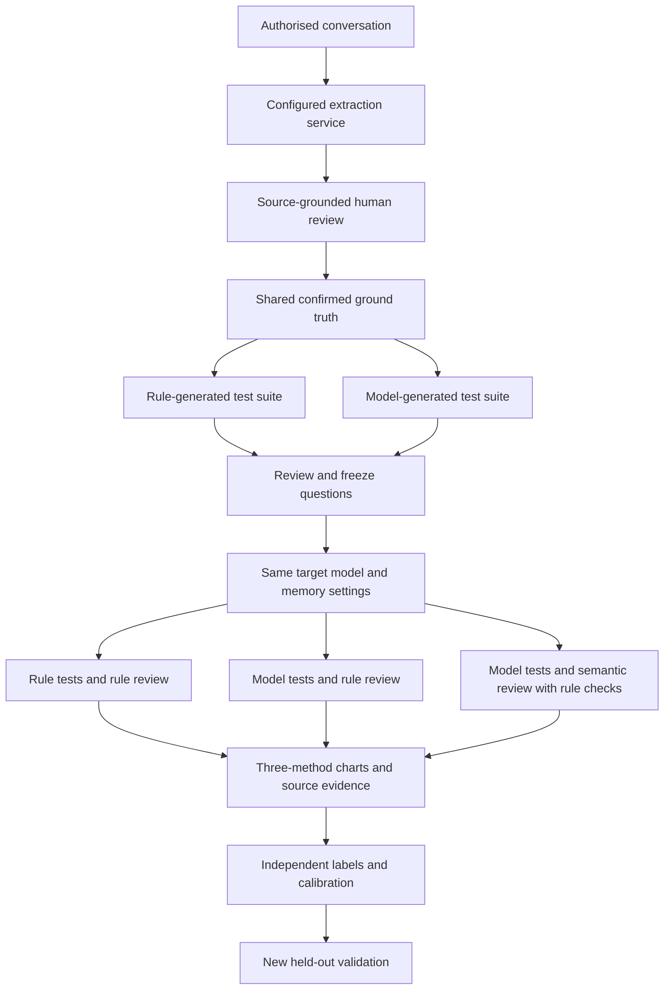

# Architecture

AI Memory Health Auditor uses a browser → REST/JSON → FastAPI → PostgreSQL architecture. The browser never receives database credentials or provider credentials.

## Default audit-method comparison

When OpenRouter is configured, New Audit defaults to all three testing/review
methods. Extraction happens once and the researcher confirms one common set
of facts. Its actual provider, model and version are recorded separately;
the rule-test condition must not be described as an entirely rule-only
extraction pipeline. This design isolates test generation and judgment;
extraction-quality ablation is a separate experiment.

Two experiment groups share an `auditor_comparison_id`. The rule group owns
its rule-generated suite. The model group owns one canonical model-generated
suite and explicitly enables `compare_evaluators`; its rule and semantic
review conditions share questions and acceptance decisions. Ordinary memory
comparisons still freeze one evaluator. For each target setting, the current guided workflow executes the
model-generated questions once for rule review, then copies the exact saved
answers and response receipts into the hybrid-review condition. The copy has
zero new target requests and records the original run and response identities.
The server requires matching target settings and the exact accepted canonical
question content before reuse. This same-answer comparison isolates assessment
changes from target-response variation. The separately generated rule suite
still has its own target execution. Temperature zero does not guarantee identical
answers across separate executions; reused answers are not independent repeats.

The saved `/audit-methods` page restores both groups after refresh and rejects
unrelated groups. Charts show automated target-answer pass rates. They do not
measure auditor precision or prove superiority across different question suites.

`failure_type` now records an observed answer category only when supported by
a classification explanation. It is independent of `test.dimension`. Rules
use narrow source-based classification and otherwise leave the type unknown.
Semantic reviewers return an explicit category and explanation under a strict
contract. Semantic/rule disagreements remain unscored pending review.
Migration 0023 preserves historical database labels but exposes their diagnosis
as unverified; old records never become newly calibrated diagnoses.

## Pipeline

1. A consented conversation is stored with its messages.
2. A configured `MemoryExtractor` derives reviewable memory candidates. `RuleBasedMemoryExtractor` is the deterministic baseline; `LLMMemoryExtractor` uses a provider-backed, schema-validated JSON contract.
3. The user confirms, edits, rejects, or adds the ground truth.
4. A configured `TestGenerator` creates tests from confirmed facts and their update/context relationships. Each generated test is quality-checked for confirmed evidence, grounding and answer leakage. Experiments can freeze a behavioural suite or either formal baseline (direct-ground-truth or fixed-template).
   With a model-backed pipeline, `AgentTestGenerator` first creates balanced coverage slots from evidence-backed rule probes, asks the selected generation model to fill them, and sends the suite to a separately selectable semantic reviewer. Both roles can use a local Ollama model or a configured cloud model. The agent makes at most one bounded coverage/duplicate repair round, then reruns local checks; unresolved duplicates or changed evidence fail closed. Rule-based generation remains the offline baseline. Both provider/model selections and each call receipt are retained with the audit.
5. Before any target is executed, a researcher can inspect the frozen canonical suite, accept/reject a test or request regeneration. Canonical changes are copied to all peer runs so a model comparison remains paired and fair.
6. A `TargetSystemAdapter` owns the lifecycle of the system being measured: `ingest → answer → trace → reset`. Foundation registers `controlled-memory`, a Target Memory Agent that independently ingests the authorised conversation into a per-run persistent memory store. The external-http adapter can call an independently hosted target through a strict ingest/answer contract. Its memory context is unobserved unless the external target supplies independently verifiable evidence; an empty controlled trace is not evidence of empty external memory. A standalone reference_target service demonstrates this separation and is not a vendor benchmark. The controlled store records writes, UPDATE/CONFLICT/CONTEXTUAL_OVERRIDE lifecycle evidence and every retrieval. `TARGET_MEMORY_WRITER=rule_based` is the reproducible default; `llm_structured` uses the experiment's frozen pipeline provider/model to model an Agent deciding what to write, with the same strict source and relationship validation. Update-aware maintenance merges exact and narrowly-defined superficial duplicates, while preserving source IDs and an event rationale. A frozen `target_memory_capacity` applies explainable retention pressure: low-priority older records become `EVICTED` and are never retrieved, but remain in the private trace; unresolved conflicts are protected even if that makes the limit soft. `weak_first_hit` exposes only the first relevant non-evicted record; `strong_rule_based` applies explicit contextual-override, update and supersession priorities; `strong_score_based` ranks relevance, freshness and context with transparent weights; `scope_aware` narrows current-task questions to project-requirement records and uses profile/preference records only for matching question intent; `temporal_importance` combines message-order recency with explicit scope/relationship importance. The temporal strategy uses the relative order of cited messages in the authorised conversation, never an audit wall-clock, and persists every score component. The evaluator-only expected behaviour and reviewer-confirmed ground truth are never sent to any target profile.
7. A configured `BehaviourEvaluator` compares responses with expected ground-truth behaviour. `LLMBehaviourEvaluator` uses strict JSON and evidence whitelisting, with an explicit uncertain outcome if the judge is unavailable or its output is invalid. Such outcomes are excluded from pass-rate denominators, with advisory diagnostics kept separately.
8. `MetricsService` computes dimension scores and a macro-average overall score.

The four stages implement `MemoryExtractor`, `TestGenerator`, `TargetAIConnector`, and `BehaviourEvaluator` interfaces. External keys are read by the backend only; provider availability is exposed without revealing keys.

## Lifecycle

`CREATED → TESTS_GENERATED → TESTS_EXECUTED → COMPLETED`, with `FAILED` for a target or evaluator execution error.

The API validates each transition. Ground truth must be confirmed before an audit can be created. Audit records retain target provider/model, memory strategy, and resolved generation, semantic-review and answer-assessment provider/model selections, alongside temperature, seed, budget and prompt-template version.

## Experiment groups

An `Experiment` is the unit of fair comparison. It freezes one test-suite configuration, including generation and semantic-review models, and has multiple audit runs representing model × memory-strategy conditions. The first run creates the canonical suite exactly once. Peer runs clone that suite, retaining a link to each source test while storing independent target responses and evaluations. This prevents LLM test generation from changing the questions between compared conditions.

Completed experiment groups can produce a fixed-timestamp artifact ZIP. It hashes the frozen suite and every included JSON payload, records configuration fingerprints and an optional build-time code revision, and contains only the post-audit safe trace view—not the raw authorised conversation, credentials or raw provider payloads. The result schema also includes source-evidence retrieval proxies (recall@k, precision@k, update/conflict coverage and unnecessary retrieval rate) so response quality can be separated from retrieval quality.

The experiment-history analytics service is read-only. It aggregates completed runs by provider/model/strategy, preserves incomplete conditions, and aligns pairwise outcomes through `suite_test_id`. It produces a downloadable CSV with condition summaries, individual run scorecards, failures and paired signals. The target agent's private memory and retrieval context remain excluded from these public reports.

The execution service is deliberately idempotent: generated tests, target responses and evaluations are durable artifacts. A retry begins at the first missing artifact, so a temporary provider failure does not repeat earlier successful requests.

Saved audit detail pages show progress and the existing recovery controls until assessment is complete. The validation workbench restores both question-ready and answer-saved conditions; question editing remains frozen once target execution has started. Switching a review condition commits its identity only after the corresponding suite loads successfully. For loaded suites awaiting execution, unresolved or empty question review blocks the recovery button. Recovery never makes an unfinished score available as a final result.

## Research validity

Operational Memory Health scores evaluate the target Agent; they do not by themselves prove that the Auditor is correct. A separate human annotation protocol and de-identified seed set live in `datasets/annotation/`. The `AuditorValidityService` compares independently labelled PASS/FAIL outcomes with automated evaluations, reporting accuracy, failure precision/recall, false-positive rate and Cohen's kappa.

The research-validation router is deliberately separate from operational audit routes. It validates a frozen annotation release, calculates extraction, relationship, test-review and evaluator metrics from explicit prediction mappings, and returns a reproducible content hash. It retains no research payload. A LongMemEval-compatible adapter provides a local format boundary. Its optional deterministic runner operates only on caller-supplied, authorised payloads: each case receives an isolated in-memory target-memory simulation, sequential user-message ingestion, controlled policy retrieval and a transparent reference-overlap evaluator. It does not write benchmark payloads to PostgreSQL, download data, call an LLM, or claim an official external-benchmark result.

### Human review in the method comparison

Pending automated judgments are loaded directly below the method chart, with
source excerpts, reference behaviour and the target answer. A reviewer supplies
an explicit name/pseudonym and saves a `reference` label (a Fail also requires an
explicit error category). Saving immediately updates the comparison using the
acknowledged persisted label and then reloads review records. Reloading the page
restores these labels; adjudication takes priority over a reference label through
the existing review API. Independent labels alone are not silently resolved.

The chart uses resolved human judgments where available and automated judgments
elsewhere, with remaining abstentions unscored and an explicit human-reviewed
caption. The original audit results and evidence remain immutable in detailed
reports. This visible reference review is not independent blind validation and
must not be used as a substitute for auditor calibration against held-out labels.

The method comparison also retains an original automated verdict distribution,
separate from the human-reviewed score overlay. Unambiguous matching questions
from model-generation/rule-review and hybrid-review conditions expose differing
verdicts and both saved answers/reasons. Shared-answer receipts establish reuse;
same-looking answer text alone does not. Historical independently executed
answers, ambiguous matches and incompatible settings retain their provenance
limits. The cross-check uses resolved human labels only and reports unmeasured
values when labels or denominators are missing. The current guided same-answer
ablation can isolate assessment changes, but it does not by itself establish
assessment accuracy or replace independent evaluation.

### Diagnostic study isolation

Repair, exploratory follow-up, intervention and test-construction studies are separate experiment groups. They retain the source run's actual pipeline and evaluator configuration, clear the primary three-review-method comparison identity, and record their study role and source run. Question generation preserves this provenance. The comparison index and direct comparison route exclude explicitly marked diagnostic groups, including historical groups whose role was already stored. Original groups, target answers and assessment evidence remain unchanged.

For historical groups whose generator omitted group-level study metadata, comparison responses recover the role from persisted run receipts. A unanimous recorded role is retained; groups containing both diagnostic and unmarked runs, or different study roles, are marked `mixed_study` and excluded from the primary comparison. Missing receipts alone do not establish a diagnostic role. The list loads receipts in one batch; detail responses reuse their already-loaded runs. This is a read-only compatibility layer and never rewrites original group configuration, scores or run receipts.

Diagnostic forks also retain the source run's persisted random seed, question budget and prompt-template version. Parent experiment defaults must not replace these execution inputs, and standalone audits retain their custom template when converted into diagnostic experiments. The parent suite mode and dimensions remain the declared generation protocol; individual method-comparison conditions explicitly choose their construction mode afterwards.

Validation workbench progress identifies the active operation: diagnosis, preparation, review saving, regeneration, restoration, history refresh, condition selection, execution, findings or comparison loading. Only the initiating action shows a loading indicator; all conflicting controls remain disabled. A synchronous action guard prevents overlapping requests before React has rendered the disabled state. Both successful completion and failure clear the action state, while saved execution evidence and frozen question rules remain intact.

The authorised conversation-data export uses the same persisted run-receipt role recovery as the experiment list, detail and safe reproducibility bundle. Exported metadata therefore agrees with the displayed study role, including historical diagnostic groups, without writing recovered values into the database. Conversation export reuses its already-loaded runs and adds no per-experiment receipt query.

### Independent judgment and category agreement

Calibration keeps pass/fail agreement separate from failure-category agreement. Category comparison uses only evaluations for which at least two distinct independent reviewers all marked Fail and all recorded a category. Complete groups are counted as category agreement or disagreement; groups missing a category remain explicitly unmeasured. Binary disagreements are retained separately. Displayed reviewer labels include their selected category, while independent blind review continues to hide labels and aggregate statistics. These counters describe supplied review evidence; they do not verify reviewer identity or establish held-out reliability.

### Pilot agreement threshold precision

Pilot readiness compares unrounded per-task Cohen’s kappa with the declared threshold. The calculation uses integer contingency counts to avoid cancellation at an exact threshold; rounding belongs only to display. Required-check details show six decimal places and explain that decisions use the original value. A value of approximately 0.599690881 is below a 0.6 threshold even when a compact chart displays 0.60. AI-assisted synthetic packages remain ineligible for formal human-evaluation readiness regardless of agreement. Repeated input-validation messages are grouped with occurrence counts while distinct problems remain visible.

### Research failure-category assessment

Research prediction inputs may supply `failure_type` only for an explicit failed verdict. Legacy failed verdicts without a category remain accepted and count as unclassified; a category is never inferred from the test dimension. Research metrics v2 classify every reference failure into one of six disjoint outcomes: correct category, wrong category, detected without a category, missed failure, uncertain prediction, or missing prediction. Detected-failure classification accuracy includes unclassified detections in its denominator. All-reference classification accuracy includes missed and uncertain outcomes, but remains undefined when any reference-failure prediction is absent. False positives remain in the binary detection metrics. The response and downloaded JSON retain classification counts and input fingerprints; old UI reports without this field explicitly show Not recorded. These metrics verify the submitted contents, not the authorship or independence of their labels.

Annotation validation responses expose the dataset’s declared `data_origin`. The UI labels it as a declaration and explicitly distinguishes format/reference checks from independent human-review verification. Historical responses without that field show Not recorded. Source declarations are unverified input metadata and cannot satisfy independence gates by themselves.

### Success criteria frozen before new formal runs

Creating a formal synthetic matrix now requires four explicit percentages: minimum failure-detection recall, minimum failure-classification accuracy, minimum test validity, and maximum false-positive rate. All values must be finite and within 0–100. The server saves the criteria, creation time, dataset fingerprint and runtime-source fingerprint in every new run's reproducibility metadata before execution. The formal-input signature binds this receipt; changing saved criteria invalidates execution, evaluation and retry. Changing the form after creation does not change the saved receipt. Legacy browser plans without recorded criteria cannot launch new formal runs; historical results remain accessible.

Inputs start blank and preserve the exact typed text, so an invalid visible value cannot silently retain a previous valid numeric state. Engineering test percentages are fixtures, not approved research thresholds. This control freezes four acceptance thresholds; it does not establish a fully preregistered sampling/repetition protocol, independent labels, unseen earlier results, or held-out reliability. Automated inspection and development continue without replacing these evidence requirements.

### Full-reference failure recall

Research metric version `research-count-metrics-v3` adds failure-detection counts over the complete supplied reference-failure inventory. Detected failures include correct, incorrect and absent categories; missed, uncertain and missing predictions remain separate. Full-reference recall includes submitted uncertain verdicts in the denominator as failures not found. Any missing reference-failure prediction prevents a complete recall score; no reference failures produces an undefined score. Existing decided-only confusion metrics remain separate for interpretation and compatibility. The UI compares both recall denominators and reports the outcome counts. Old reports without this field show Not recorded rather than recomputing or guessing. Versioned downloads include the new metric and the canonical dataset/prediction fingerprints. This arithmetic does not verify annotation authorship, source independence, target-answer provenance, or research acceptance.

### Saved-threshold checks for supplied evidence

`POST /api/v1/research/formal/acceptance-check` reads the acceptance protocol from a saved formal audit. It rejects missing protocols, modified frozen inputs, and a dataset whose canonical fingerprint differs from the reviewed release. Labels and predictions remain request-scoped. Failure recall and classification use the full reference-failure inventory; missing failure predictions prevent a complete score. False-positive rate requires every reference pass to have a decided prediction. Grounded test validity is the proportion of supplied reference tests that are grounded and accepted, with full test-assessment coverage required. It is not test-review classifier accuracy and does not certify a newly generated probe inventory.

Each measure includes numerator, denominator, definition, threshold, observation and evidence status. Exact rational comparisons use the raw integer counts and saved percentage, not displayed rounded scores; both minimum and maximum boundaries are inclusive. The v2 endpoint scopes arithmetic to the selected source scenario. Predictions from any other scenario are rejected. It resolves the selected run’s canonical question links and checks exact reference-answer text and the corresponding saved automated verdict/category. Missing predictions, saved answers or verdicts remain incomplete; duplicate saved answers/verdicts or attempted reuse of one reply for multiple reference responses remain ambiguous. A canonical receipt hash includes run identity, every candidate answer hash, saved verdict facts and submitted predictions, including ambiguous candidates. `all_thresholds_met` describes numerical arithmetic; `saved_result_thresholds_met` also requires complete saved-evidence binding. The UI displays these checks separately and never treats either as proof of independent evaluation. The endpoint does not call the model or change stored records. Actual answers differing from the frozen reference corpus use the post-execution saved-review path below; held-out protocol and human independence are unproven.

### Post-execution reviews of actual saved answers

`GET /api/v1/research/formal/{run_id}/reviewed-acceptance` reads an unchanged server-saved acceptance protocol and the completed run’s actual answers, automated verdicts, and resolved human-review records. It reuses the canonical resolution rules: modified independent labels invalidate stale adjudication, rather than falling back to an older reference. Missing responses, verdicts or resolved labels prevent full response-metric acceptance; duplicate answers/verdicts are excluded as ambiguous. Unknown human failure categories prevent classification acceptance. Uncertain automated failures remain unsuccessful detections; uncertain automated passes prevent a complete false-positive rate. Grounded-test validity remains a check of the frozen accepted suite rather than new-generator validation.

The path does not compare actual answers with old corpus example responses or modify thresholds. A canonical receipt fingerprints saved answer text hashes, observed classification evidence, verdict facts, review versions and the protocol. Historical categories inherited from the test dimension remain excluded from observed classification, including in the uploaded-evidence binding path. The UI distinguishes coverage, current adjudication with two recorded pseudonyms, numerical results, and independent-evaluation limits. It clears previous results during refresh and indicates only the active operation. No model calls or uploaded research files are needed. Distinct pseudonyms do not verify human authorship/independence; these results do not certify held-out validity or the full proposal.

### Recovery of saved threshold experiments

`GET /api/v1/research/formal/saved-runs` provides a bounded, deterministic server index independent of browser session storage. It filters formal-matrix records in SQL and returns paged model/strategy/time/status descriptors. Count and page retrieval require two database queries; no source history, answers, credentials or participant labels are returned. Dates explicitly carry UTC. Missing or structurally invalid acceptance protocols remain listed with criteria unavailable; listing does not verify input signatures or certify an experiment. The actual threshold endpoints retain their signature and evidence checks.

The threshold UI merges the current browser plan with the server page by run identity. Model, strategy, date and display rank distinguish choices without printing internal IDs. Loading disables checks, failures support refresh, pagination is bounded, and a shrinking list returns to a valid page. Refresh/page/selection changes clear prior results and discard late checks. Saved-review checks can therefore resume with no local plan or uploaded file. This recovers access to threshold checking and review links; it does not recreate all original matrix-execution controls or establish independent research readiness.

Saved experiment choices use the recorded executor provider. A rule executor is always labelled as the local rule-based baseline, even when its model metadata contains a cloud-model default; that metadata is not evidence of an actual model call.

### Recovery of a complete frozen execution plan

New formal matrices save the complete original response as `formal_matrix_manifest` in each condition before input signatures are calculated. The manifest contains scenario and condition identities, counts, dataset and pilot references, and frozen success criteria; it does not contain uploaded label files or target answers. `GET /api/v1/research/formal/{run_id}/plan` restores this manifest only when every listed condition exists, shares the same manifest and protocol, belongs to the expected experiment, and still passes its input signature. A missing entire scenario cannot silently shrink the recovered study. Older runs without a complete manifest are explicitly refused for execution-plan recovery, while their saved results remain accessible.

The UI action Restore execution plan updates the browser's plan without calling the target model. Running conditions remains a separate explicit action, using saved lifecycle states to skip completed calls. Runtime source drift is still checked at execution, retry and evaluation; recovery is a read of original inputs, not permission to resume under changed software. This mechanism does not establish independent labels or a full held-out research protocol.

Recovery, creation and bulk execution share a UI operation lock. A pending recovery disables running the old plan; an active creation or execution disables plan recovery. This prevents completion counts being applied to a different selected matrix.

### Integrity of reliability evidence

Bulk evaluation review requires exactly one assessment per question and follows that assessment's exact response identity. The response must belong to the same question and audit; labels must belong to that audit as well. Multiple unassessed attempts remain inspectable through the explicitly assessed response; they are not selected by row ordering. Multiple assessments for one question are excluded rather than arbitrarily selected. Frozen formal acceptance remains more conservative about multiple saved answers.

The reliability summary reports `evidence_integrity` for all completed audits and each declared method: saved questions, usable assessed questions, excluded questions, reasons and discarded labels with another audit identity. Review coverage uses all saved questions as its denominator, so corrupt or missing records cannot improve coverage merely by being omitted. Excluded evidence is neither a model failure nor a pass. Integrity counts reuse already loaded rows and preserve bounded bulk-query behavior. Saved threshold receipts now include all recorded review versions, including excluded records, so a changed excluded label still changes the evidence receipt. This is engineering integrity checking, not proof that submitted labels were independently produced by humans.

The per-assessment human-review write endpoint enforces the same unique-assessment and exact question/audit response binding before any label is inserted or updated. Conflicting assessments and mismatched answers return a conflict response and preserve existing labels. Reliability header and method-table coverage counts use all saved questions when integrity metadata is present; older response formats retain their legacy fallback rather than inventing a denominator.

### Predeclared repeated formal conditions

Formal matrix v7 accepts an integer `repetitions` from 1 to 5 (default 1), saved before execution in the complete plan's `repetition_count`. Each scenario receives every declared condition in each round, with separate audit and answer identities and the same recorded seed. All copies use one canonical reviewed suite. The complete expected run set and repetition metadata are bound to input signatures, so changing repetitions requires a newly reviewed dataset version. Recovery checks conditions × repetitions, not only distinct conditions.

Formal creation now uses the ordinary safe reproducibility snapshot, recording full configuration and prompt fingerprints, memory profile, seed-control declaration and runtime provenance. Repeats under identical settings therefore aggregate as one condition in existing analytics rather than being treated as configuration-unknown single runs. The isolated integration test executes six actual local rule runs (two conditions × three rounds) and verifies two completed-condition summaries, each containing three runs, plus unchanged recovery of the 30-run full matrix. These are engineering fixtures, not independent human experiments or real-model empirical results.

UI preview displays planned runs per scenario and freezes the chosen count. Calls still start explicitly. Repetitions share histories and questions; they cannot substitute for independent held-out scenarios. Cloud seeds are recorded configuration identifiers and do not guarantee exact replay. A deterministic baseline or a fixed seed may show zero variation; a zero-width interval does not prove general certainty.

The saved-run index exposes a bounded repetition position when both stored integers are consistent (1 ≤ position ≤ count ≤ 5). Invalid or legacy metadata is omitted rather than causing the whole index to fail. This is descriptive metadata, not input-integrity certification. Cached selection labels use condition identity modulo the declared condition count and show the repeat separately; choosing a repeat still submits its exact saved audit identity. Execution progress counts runs, rather than distinct strategies.

### Supplied development/formal history separation

Formal creation optionally accepts a separate development annotation dataset. Before persistence it hashes complete ordered role/content sequences after NFKC, case and whitespace normalization, ignoring message and conversation IDs and timestamps. Any formal/development overlap or duplicate formal history rejects creation. Shared isolated common messages are not sufficient to reject two different histories. The development release fingerprint and a narrowly worded `no_normalized_history_overlap` result are saved in the frozen acceptance protocol; development text is neither persisted nor supplied to the target. Plans without this input record `not_checked` and preserve their exploratory workflow.

This checks only the two submitted sets. It does not establish that the development set is exhaustive, detect semantic paraphrases, prove authorship or unseen results, choose a sampling protocol, or certify a complete held-out study. UI offers the check explicitly, requires a readable file when enabled, and shows its recorded scope when inspecting the saved plan. Independent review remains a separate research evidence requirement.

### Predeclared analysis choices

An optional `FormalStudyDesign` records the scene inventory/selection rule (20–1000 trimmed characters), one primary outcome from the supported overall/dimension scores, the planned source-history analysis unit, and reporting incomplete results without imputed scores. Creation requires a development dataset and passes content separation checks before persistence. The design is saved inside the acceptance protocol before target calls and is covered by the existing full input/manifest signatures. UI creation is explicit and plan recovery shows the original choices. Legacy/exploratory plans are visibly marked as lacking an analysis plan.

These are frozen declarations, not proof that sampling was unbiased or unseen, not a verified independent reference, and not a completed source-history uncertainty analysis. Current per-scenario comparisons remain per-scenario; freezing the declared unit does not manufacture across-history statistics. Full study-level aggregation and independent empirical evidence must be verified separately.

Recovery compares peer JSON against the original signed manifest rather than a current-schema dump with injected optional defaults. Valid older signed manifests therefore remain readable without rewriting their recorded protocol; actual input edits, missing peers, different protocols and incorrect budgets remain rejected.

### Across-history descriptive comparisons

`GET /api/v1/research/formal/{run_id}/study-summary` restores and verifies the complete signed plan before reading saved results. It never executes a target or changes review labels. The selected primary outcome comes from the frozen design; a plan without that declaration is explicitly exploratory and uses the four-dimension macro mean. Each run requires one assessment per saved question with an exact response/question/audit link. Missing or invalid evidence prevents that run from contributing. Uncertainty in relevant questions prevents a primary score.

Every planned repeat must have a usable primary score before its history contributes. Repeat means are averaged within a history, then histories are equally weighted. Raw pooled question counts and repeated answers are not the sampling units. Incomplete history counts, completed/scored runs, uncertainty and evidence issues are returned separately. Whole-history normalized copies cannot count as different histories in this view, even in older exploratory plans. Declared reader/pipeline/judge settings must match across scenes for each condition.

Descriptive 95% percentile bootstrap intervals resample measured histories (2,000 fixed-seed samples), requiring at least two. Pairwise differences use only shared complete histories and are candidate minus reference in percentage points. Available-case intervals do not correct selection bias, establish independence or justify general superiority; zero variation does not prove certainty. The chart and coverage tables retain these limits. This summarizes automated target-answer judgments, not independently verified auditor detection/classification validity.

Saved response/test/evaluation loading is batched after plan verification. Original per-scene results and threshold checks remain available. The new React view clears stale results when its plan/execution state changes and ignores late replies from another plan.

### Evidence-bound scene exports

Source-history summary v2 includes the reviewed dataset fingerprint, original saved manifest checksum, current analysis source checksum, and a checksum of saved run lifecycle/input fingerprints, all recorded target attempts and all assessments. Excluded/unassessed evidence contributes to the checksum without replacing the explicitly assessed answer or entering score denominators. Raw answer text remains server-side; exports contain summaries and checksums. `receipt_sha256` binds the report envelope without its own receipt field. Canonical serialization sorts keys, normalizes integral floats and UTC datetimes, and rejects non-finite numbers so JSON round trips preserve the receipt.

The UI downloads only the currently loaded evidence-bound summary and removes it when the plan or execution state changes. These are change-detection checksums, not keyed digital signatures, provenance certificates, external-export authentication or proof of independent human labels. Existing exploratory and missing-evidence notices remain visible.

### Checking an exported scene snapshot against the server

`POST /api/v1/research/formal/{run_id}/verify-summary` accepts a request-scoped summary object. It first checks the supported v2 receipt and canonical self-checksum, then recomputes the selected plan's summary from authoritative saved data. Distinct statuses identify a changed file, different original plan, updated saved evidence, changed analysis source, or differing result values. Recomputing a checksum after editing exported scores cannot produce a server match. A matching partial export still certifies only correspondence to the current saved snapshot, not complete coverage, independent labels or study validity. Verification makes no model calls and does not persist imported files or review labels.

The React verifier accepts a JSON object under 1 MB and requires a selected saved plan before checking. Invalid replacement files remove the old file and result; changing plan/execution invalidates pending replies. The imported file may remain selected when switching plans, allowing an explicit different-plan check, while the old verification result is cleared. Existing summary/threshold actions remain separate.

### Consistent assessment integrity in scoring and comparisons

The score calculator now excludes every assessment for a multiply assessed question rather than retaining the first row. Single-audit results additionally require the exact assessed response to belong to the same question and audit. Public counts, failure details, dimension scores and overall averages are built from this same eligible set. `expected_tests` and `excluded_evidence_count` preserve saved-question coverage; exclusions are neither passes, failures nor uncertainty. Existing valid assessed attempts remain usable even when another unassessed response exists.

Both experiment paired analytics and before/after evidence comparison apply the same unique-assessment and exact-answer association checks. Repeated canonical comparison keys cannot be paired by row order. Experiment pairing separately counts structural/assessment exclusions and genuine uncertain verdicts, retaining shared saved-question counts. The before/after loader uses three bounded logical reads per run rather than per-question assessment/response queries. Existing scoring-standard and saved-answer lineage checks remain intact.

The dashboard outcome heading displays usable question assessments over all saved questions when evidence is excluded; CSV records coverage separately. Exclusion warnings make partial averages visible. Records are preserved for inspection rather than deleted. This improves integrity of automated scores, not independent evidence of auditor reliability. Older test doubles were updated to represent correctly associated batched records while preserving their original protocol/lineage assertions.

When any saved question has excluded assessment evidence, the computed formal four-dimension overall score is unavailable even if each dimension retains other decided answers. The ordinary available-evidence average remains inspectable, while the dashboard explicitly labels it Partial result. This prevents a perfect remaining-case average from masquerading as a complete assessment.

### Dimension-level evidence availability

Dimension scores retain expected saved-question counts and excluded evidence counts in addition to decided/uncertain counts. The score calculator derives exclusions from the mapped test inventory, preserving the difference between a genuinely untested dimension and one whose saved assessments are missing, duplicated or linked to another answer. Exclusions do not create a zero percentage or a failure count.

The report, radar accessibility text, grouped score/failure charts, detailed statistics and CSV show Evidence unavailable when a dimension has excluded questions and no definitive score. Uncertain usable judgments still show Awaiting review, while dimensions with no saved questions show Not tested. Aggregate frontend statistics carry excluded counts across repeats. Existing valid scores remain percentages and missing states remain unmeasured.

### QA discovery: general preference versus contextual override

An actual UI-only Nacre synthetic development flow called the configured OpenRouter extractor and test generator, confirmed five AI-reviewed source facts and prepared six Qwen conditions. Before target execution, inspection found a conflict probe asking only for general language preference while its expected behavior additionally required a project override. The operator rejected it. Two real replacement requests were blocked by the existing answer-leak gate; the original rejected question was preserved and execution remained disabled. No target answers or independent human labels were produced in this attempt.

Quality validator v14 rejects this bounded general-only/contextual-override mismatch rather than judging a correct general answer as a conflict failure. LLM replacement requests now use a temporary one-question generation budget and explicit one-test relationship instructions, preserving the saved audit's original budget and all leakage/provenance checks. This does not guarantee arbitrary semantic test validity. Software changes do not authorize replaying an old frozen runtime; new-version UI validation must use newly created records. The incomplete development records are retained, not converted into successful research evidence.
