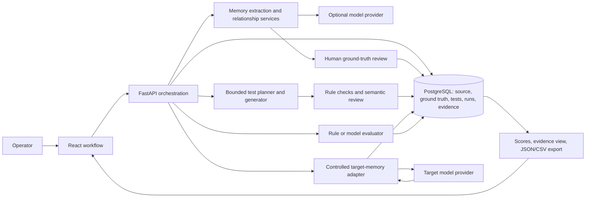

# Supplementary project narrative — internal background draft

**Status: internal background only; not a submission deliverable.** The team requested an experiment report only. The sole final report is [`docs/EXPERIMENT_REPORT_2026-10-28.md`](../EXPERIMENT_REPORT_2026-10-28.md). This older, broader project narrative is retained for background and must not be presented as a separate paper or final report.

## 1. Project summary and team

**Project:** AI Memory Health Auditor  
**Course and track:** ELEC5623 Applied Generative AI in Engineering; Track B — Product That Helps AI Work Better  
**Group:** Group 2  
**Members named in the approved proposal:** Shuyuan Wen, Chongtai Jia, Yichao Wang, and Chayapat Leardngammongkolkul. Individual completed-work statements remain pending each member's confirmation; planned role assignments are not treated as evidence of completed contributions.

The project implements a web application that lets an operator audit how a controlled conversational-AI system remembers and applies conversational facts. It combines source-backed memory review, ground-truth confirmation, test generation, a configurable target-memory layer, response evaluation, and evidence-linked reporting. Experiments A, B, and C each have retained target responses and analysis records. The strongest current result is a clear Weak/Strong separation in the archived, small-sample C compatibility run (15/42 versus 30/42), with Strong scoring higher in all three repeats. This is a descriptive target-memory result, not proof of Auditor validity or a full LongMemEval score. Human-review provenance conflicts, unresolved labels, and limited benchmark coverage prevent a formal claim that all proposal acceptance criteria have passed. A post-fix live intake retest confirms that all three intake agents complete on one synthetic case; its 14 candidate memories remain unreviewed and it has no target results, so it does not satisfy the full current-source walkthrough requirement.

## Abstract

The AI Memory Health Auditor is a web application for evaluating a controlled conversational AI's long-term memory behaviour. It guides an operator through authorised conversation intake, source-backed memory review, controlled target configuration, behavioural testing, and an evidence-linked report. It measures Accuracy, Freshness, Conflict Resolution, and Appropriate Use. This report describes the implemented system, its verification boundary, and the original evidence for Experiments A, B, and C. The application repository is at remote `main` commit `40876e47e44f2af18187766a46976fe3bb15c3a5`, with local uncommitted changes retained and identified by the current source manifest. A separately versioned archive now contains original A/B/C collections and retrospective review records. All three collections executed, but formal extraction completeness, independent auditor reliability, and all proposal acceptance criteria are not established. Reviewer provenance corrections remain user-reported and conflict with the original return declarations; unresolved cases and failures are preserved.

## 2. Problem definition and contribution

Long-term assistants can omit facts, reuse superseded facts, fail to resolve incompatible facts, or apply a valid fact in an unsuitable context. The proposal addresses this through a user-facing audit workflow built around confirmed source evidence. The prototype treats the target as a controlled memory-enabled system and does not claim access to proprietary commercial memory stores.

The target users are people who depend on persistent conversational context and developers or researchers comparing memory-system configurations. The prototype addresses the observable interface between a user history, a system's stored memory, and its later answers. It does not inspect hidden state inside commercial assistants or claim that a simulated memory store represents every deployed memory architecture.

The four behavioural dimensions are Accuracy (retrieve the supported fact), Freshness (prefer the currently valid fact while preserving history), Conflict Resolution (notice incompatible active facts and avoid unsupported selection), and Appropriate Use (apply facts only within their stated scope). These dimensions turn common memory failure modes into testable tasks. The contribution is a user-centred audit workflow that ties each test and failure back to source messages and operator-confirmed memory records. It is a contextual, evidence-oriented application of existing memory and evaluation ideas, not a claim that conversational-memory evaluation itself is new.

The key requirements are source-authorised import; source-linked memory and relationship review; grounded tests across four dimensions; a controlled target environment; saved run settings and answers; auditable evaluation and category labels; result visualisation and export; and repeatable Weak/Strong comparisons. The proposal acceptance criteria additionally require independently validated extraction, grounded executable tests, held-out evaluator validity, traceable reports, and reuse of frozen inputs. The requirements and current gaps are mapped in REQUIREMENTS_TRACEABILITY.md.

## 3. Related work and novelty

LongMemEval provides 500 manually created questions for information extraction, multi-session reasoning, temporal reasoning, knowledge updates, and abstention. It standardises long chat histories for evaluating assistant memory and helps motivate the project's Accuracy and Freshness cases. LoCoMo uses long conversational histories and asks question-answering, event-summary, and multimodal tasks; its human-checked dialogues highlight the importance of temporal and causal consistency (Maharana et al., 2024; Wu et al., 2025). BEAM extends the benchmark landscape with longer, coherent conversations and a wider set of memory abilities; the published benchmark contains 100 conversations and 2,000 validated questions (Tavakoli et al., 2026). These benchmarks score target-system behaviour on a fixed external dataset. They do not, by themselves, supply a user's personalised and operator-confirmed ground truth.

Commercial and open memory systems also evaluate their own memory designs. Mem0 studies extraction, consolidation, and retrieval of salient facts and compares graph and text memory against several systems on LoCoMo (Chhikara et al., 2025). Zep describes a temporal knowledge graph that records evolving conversational and structured facts, including their temporal relationships (Rasmussen et al., 2025). These systems focus on implementing or improving memory infrastructure. Their reported scores cannot be assumed comparable to this project because datasets, graders, prompts, target models, and scoring rules differ.

The project's narrower distinction is the audit process: an operator confirms the source-backed facts first, the system generates tests against that reviewed state, and failures expose a path from source evidence through expected behaviour to the target response and evaluation. This can be used to compare a controlled memory configuration without access to proprietary memory internals. The planned novelty is therefore the workflow and traceability of personalised behavioural auditing, rather than a new memory architecture or a replacement for established benchmarks. The present evidence only demonstrates an implemented prototype and small local comparisons; it does not establish superiority to Mem0, Zep, or the benchmark baselines.

## 4. System design

The application accepts a synthetic or authorised conversation, extracts candidate memories, lets an operator confirm or correct the ground truth, configures a controlled target, generates and reviews questions, executes an audit, and reports scores and supporting evidence. PostgreSQL stores conversations, message provenance, memory records, relationships, tests, answers, evaluations, and run configuration. FastAPI exposes the API and orchestrates the workflow; React presents the staged review and results interface. Weak and Strong target policies vary retrieval/update behaviour while the experiment records the other declared settings.

Figure 1. Data and control flow of the implemented audit workflow.

The diagram shows separable roles that matter for interpreting results. The extraction pipeline proposes candidate facts; the operator establishes the application ground truth. Test generation reads the confirmed facts and their evidence, while the controlled target maintains its own private memory namespace. The target is queried through a model connector. Evaluation compares the answer with the reviewed expected behaviour, and the report links the score to stored sources, questions, answers, and evaluator outputs. The target must not receive hidden test answers or reference labels through its retrieval context.

The backend supports rule-based and provider-backed implementations behind service boundaries. This permits an offline demonstration and controlled tests without requiring a cloud account. A cloud-model run also depends on external availability and provider sampling; a stored seed is provenance, not a guarantee that the provider used it. The current source package contains setup instructions and excludes the local database and experiment/reviewer data. The source archive is not a licence, data-permission, or security certification.

The saved presentation comparison used OpenRouter with target `openai/gpt-6-luna`, a `rule-based-v4` generator/evaluator, `controlled-memory-v35` target adapter, and `rule-based-target-memory-writer-v6+rule-based-memory-extractor-v25` writer. It recorded temperature 0 and seed 42; provider-enforced seed determinism was not established. These are run-specific historical settings, not a statement about every available workflow.

## 5. GenAI and agent component

The system does not use one autonomous agent to make every decision. It uses bounded model-backed roles inside an ordinary API workflow. The extraction role proposes structured memories and source references; relationship logic identifies update, conflict, and contextual-override links; a human reviews candidates before they become ground truth. The test-generation agent builds a coverage plan, requests structured question candidates, runs deterministic evidence/shape/duplicate checks, asks a semantic critic to identify intent-level duplicates or quality problems, and uses a bounded number of repair/fill rounds. The API limits the loop; it is not an open-ended tool-using agent.

The target-memory retrieval component receives the current question and records from the target's own namespace. It selects only supplied memory IDs, respects configured record and context limits, includes both sides of unresolved conflicts when relevant, and does not receive the reference answer or test metadata. A target-memory writer and retrieval policy construct the controlled Weak or Strong configuration. This separation helps prevent evaluation leakage and makes the controlled target inspectable, but it remains a local simulation rather than an integration with a commercial assistant's internal memory.

The evaluator can use deterministic rules or a model-backed judge. Deterministic rules are preferred where lexical or structured evidence is sufficient; model judgements are validated against structured output schemas and retain uncertainty when evidence is insufficient. Human labels remain necessary for independent validity claims. Model outputs are not automatically correct, and a generated explanation is not proof of its own correctness.

The archived Phase 4 A run used the OpenRouter model ID openai/gpt-6-luna for target responses with rule-based pipeline/evaluator settings in representative recorded runs. The archived C collection used that target model with a gpt-4o-2024-08-06 grader; C v5 used GPT-6 Luna for both target and grader. These are run-specific facts. The presentation database comparison used GPT-6 Luna as target with rule-based generation/evaluation. It should not be confused with the separately selected shared Agent model in the New Audit configuration.

## 6. Implementation and application demonstration

The implemented flow is: choose or import a conversation; review extracted memories and source citations; resolve relationships and confirm the ground-truth state; configure the target and budget; review source-supported questions and ability coverage; execute the target run; inspect score evidence and uncertainty; and export the saved run. The UI contains separate Dashboard, New Audit, History, Before & After, and Audit Methods areas. The workflow surfaces the data origin and authorization decision before processing. It explains that an API key remains on the backend when a cloud provider is selected.

Question counts are allocated according to distinct evidence-backed slots. The project previously required two questions for each of the four abilities; this was not required by the approved proposal and blocked valid small audits whenever one dimension had only one supported question. The updated allocator aims for at least one supported question per ability and distributes additional slots within available evidence. It still blocks when any ability has no valid slot or the total requested count cannot cover all four. This change is reflected in the current New Audit workflow tests; a dimension with one question is reported with its sample count rather than treated as a reliable estimate.

The current code contains controlled-memory target adapters, rule and model extraction/evaluation boundaries, coverage-aware test generation, traceable audit results, exports, and workflow recovery. The latest source archive is reproducible from the saved package script and per-file manifest. The working-tree modifications are not committed to remote main; the exact assessment ZIP and its manifest bind the local source snapshot. The source package also includes an offline start path using local rule-based services. Historical clean-start evidence is tied to the prior frozen snapshot; a complete clean install, end-to-end audit, and export comparison on the exact latest local package remain pending.

Screenshots should be selected from a fresh walkthrough and captioned with the exact source manifest and run ID. Screenshots previously shared in chat show the current configuration and coverage warning, but they are not a complete end-to-end receipt and do not verify that an audit was run. Do not present a static image as evidence of a successful live provider request.

## 7. Evaluation method

The four target-memory dimensions are Accuracy, Freshness, Conflict Resolution, and Appropriate Use. Report dimension score as decided valid passes divided by the stated valid-test denominator. A dimension with no valid decided tests is unmeasured; it is not a zero. Report the four-dimension macro-average only when all four dimensions have measured scores, or label a partial mean with its measured dimensions.

The Auditor itself is evaluated separately against reviewed labels: memory inclusion/relationship quality, test validity, failure detection, classification accuracy, and false-positive rate. Use raw TP/FP/TN/FN and unresolved counts alongside percentages. Automated target scores do not measure evaluator accuracy.

Experiment A compares direct questions, researcher-reviewed fixed patterns, and contextual/indirect tests under equal budget. Experiment B compares Weak and Strong memory policies on the same frozen suite and target settings. Experiment C checks relative Weak/Strong ordering against a compatible LongMemEval subset. These definitions come from the approved proposal; similarly named UI workflows do not establish that a formal arm was run.

## 8. Results

### Product and engineering verification

The saved local presentation group `EXPD9C66FE3D5F946998AF5A8A0A3B272C9` has six completed runs (three per strategy), 48 saved answers/evaluations, an export reconciliation receipt, and matching question/evidence content across all six runs. Its CSV SHA-256 is `45002a9c6719212d05ff8e925066a0fff4ccacc764335419a75ee7f0f9dff9be`; its frozen-suite SHA-256 is `ca10a8eb1a53de064adb145d54c3c888745ae030c1fbbbce7e5e78b25b7495fe`. It remains **historical exploratory engineering evidence**: no final Git binding or human reference labels. A newer local synthetic three-method smoke completed under comparison `EXP1FBCD4858ABC48B69E296BC41BFB170A`; its rule-based question generator accepted 8/8 and all three method runs reached Results. Four of 24 automated judgments await human review. The run IDs and bounded scores are in `CLEAN_START_VERIFICATION.md`. This is product-path evidence for the modified local tree, not a proposal experiment or formal validation. The clean-start install remains an earlier frozen delivery snapshot; it confirms migrations, health, build and focused workflow checks for that snapshot, not a clean installation of the newest source tree. Later evidence-aware quota tests passed 40 frontend workflow tests and 71 targeted backend tests. The updated review analyser and evidence inventory are covered by the full `scripts/tests` suite, which passed 73 tests. These are engineering checks, not current full backend/frontend regression or research validation. The evidence-aware 8-question example with capacities 6/2/1/2 allocates 3/2/1/2; the interface does not require two questions for every dimension.

The current assessed-source archive is rebuilt separately from local experiment/reviewer data and has per-file hashes in `output/proposal-delivery/source/source-manifest.json`. The A/B/C research evidence archive is kept separately at `research/evidence-20261027/`; it includes reviewer identities and result-association material and must not be reused as a blind packet. Neither archive is a signed final report or a complete privacy/licence certification.

### Acceptance-criterion status

| Criterion | Evidence-based status |
|---|---|
| AC1 — memory processing | Implemented review and source-linking workflow; formal extraction precision/recall and relationship accuracy remain unestablished because the complete reference inventory and eligible independent validation are not available. |
| AC2 — grounded executable tests | Partly supported. The generator has evidence gates and the A/B/C runs contain executable tests; the latest retrospective recheck leaves 13 of 48 test-validity decisions uncertain. |
| AC3 — held-out auditor validity | Not established. The review record has unresolved labels, one critical-severity disagreement, provenance conflicts, and no supported frozen pilot-threshold result. |
| AC4 — traceable reporting | The six-run current-source Weak/Strong demo reaches Results and reconciles all 48 JSON/CSV evaluation IDs. Its initial intake failure is retained. After the budget fix, a separate 28-message synthetic conversation with 14 user source messages completed all three agent roles and produced 14 candidates plus two advisory flags, but stopped at operator review; no target run was made on that conversation. A full current-revision intake-to-results walkthrough remains outstanding. |
| AC5 — reproducibility | Frozen inputs, settings, receipts, failure states, and repeated runs are preserved. Provider defaults, recorded-only seeds, reconstructed compatibility requests, and correlated cases limit exact replication and generalisation. |

### Review-feedback reconciliation

The latest user-provided 40-item feedback matches all 40 decisions in the stored Shuyuan recheck transcription. It labels 13 questions uncertain; six history-only database answers as non-critical Freshness failures; six candidate memories invalid; three reference units valid but not covered; two stale-answer defects as P4-H1-STALE and P4-H3-STALE; and nine additional non-critical failures as Accuracy rather than Freshness. It also labels R-23b35e11a5783061 as a critical Accuracy failure. These are review inputs, not a new independent first-pass: the Chongtai 40-item archive was prepared with AI, after exposure to both first-round judgements, and marks that same critical decision uncertain. The user’s project-owner judgement is preserved, while the conflicting first-round and AI-assisted labels remain visible; formal two-return consensus counts are unchanged. The three files uploaded again on 28 October are byte-identical to the already stored copies. The structured input, original returns, recheck archive, hashes, and comparison are retained separately under the local Phase 4 review evidence; none of these reviewer files is included in the assessed-source ZIP.

### Experiment A

**Experiment A target collection executed; formal discovery claim remains unmeasured.** The restored `A-live.json` contains 36 actual answers: three histories, three methods, four questions per method/history. The retrospective review agrees on 30 responses (27 fail, 3 pass) and leaves six uncertain. Against those decided labels, automatic failure detection is 27/27 and the three decided passes are TN. These conditional figures do not establish an independent held-out result. The source-bound human review still marks 13/48 question-validity items uncertain overall, and condition-level defect mapping is incomplete or unresolved; formal distinct-failure discovery rate remains null. The three methods are direct questions, researcher-reviewed fixed templates, and contextual/indirect tests. Exact requests, conditions, exports, frozen defects and limitations are in the restored Phase 4 evidence directory.

### Experiment B

**Experiment B target collection executed; evaluator reliability remains limited.** The restored `B-live.json` contains 72 canonical included answers over three template-related synthetic histories, two retrieval policies and three repetitions. Four noncanonical recovery answers are preserved separately and excluded. The automated rule evaluator reports pooled macro averages of 25.00% for Weak and 97.22% for Strong; Strong's repetition scores are 100%, 100%, and 91.67% (population SD 3.93 percentage points). These are target-memory results, not Auditor accuracy. In retrospective human comparison, 71/72 answers are decided: TP=27, FP=1, FN=8, TN=34, with one additional automated-uncertain failure. Recall is 27/35=77.14% on decided failures, or 27/36=75% when the automated-uncertain item is included. Strong contains one candidate false positive and one uncertain response; reviewer disagreements and source limits remain. Histories are related and repeats are correlated, so these results do not establish generalisation or a formal held-out threshold.

### Experiment C

**Experiment C has two separately preserved local compatibility runs.** The archived Phase 4 C collection uses 14 of 500 official Oracle cases, two memory policies and three repeats: 84 answers and 84 usable LongMemEval-style judgements. Weak scored 5/14 in each repetition (15/42 overall); Strong scored 11/14, 10/14 and 9/14 (30/42). Strong ranked higher in all three repeats, matching B's ordering. This is a small local compatibility adaptation, not a full official benchmark; cases repeat, and the grader is automated rather than human. A separate local v5 candidate run uses the same 14-question count but new target/grader calls: Weak 12/42, Strong 35/42; do not merge the two datasets. Its target and grader both use GPT-6 Luna, and its post-hoc lexical proxy is not the Auditor's four-dimension score. The earlier 2-case pilot and Qwen GUI pilot remain separate historical records.

## 9. Reflection, limitations, and next steps

The implementation supports a complete staged audit workflow and produces a useful evidence trail. The controlled memory design allows more precise comparisons than a demonstration against an uncontrolled commercial assistant, and the coverage warning makes limits in the source evidence visible before execution. The design also keeps target performance separate from evaluator quality. The strongest engineering lessons were that memory status and scope must be explicit, question quotas should reflect valid source evidence, and every reported percentage needs a denominator that exposes unanswered or uncertain cases.

The evaluation is still small and partly retrospective. A covers only three synthetic histories and 36 answers. B covers three related histories and 72 canonical answers over three repeats; those observations are not independent samples. C uses 14 out of 500 Oracle cases, reuses cases across runs, modifies the external benchmark execution, and relies on automated grades. The grader shares the model family with the target in C v5. None of these conditions supports population-wide or commercial-system claims. The local C v5 score and archived C Phase 4 score are separate collections and cannot be combined.

The principal unresolved research limitation is the reference set. The user-provided 40-item recheck clarifies several ambiguity and classification decisions but does not replace the two first-round returns. The original JSON declarations and the user's correction about independent blind human work conflict; the AI-prepared Chongtai recheck adds post-exposure labels but cannot certify human independence. The formal two-return analysis consequently keeps 32 items unresolved, including question validity, candidate validity, reference coverage, the R-23b35e11a5783061 critical-error disagreement, and category disagreements. Memory-reference recall and formal distinct-defect discovery rate remain null. Report conditional A/B confusion matrices only with the stated denominators; do not describe the recheck as a new blind held-out evaluation.

Next steps are to obtain a human-confirmed provenance statement and fresh independent first-pass returns on a versioned packet that has not exposed automated scores; adjudicate disagreements under a frozen rubric; freeze pilot-derived thresholds before any unused held-out evaluation; run the final source package end to end and bind answers and exports to one run ID; record a novice user walkthrough; obtain each member's actual contribution statement; and confirm dataset, citation, and third-party licence permissions. If those steps cannot be completed before submission, report them as limitations rather than imply completion.

## 10. Broader impacts and responsible use

Conversation histories can contain sensitive personal or business facts. The application therefore asks for authorisation, supports synthetic data, retains source links for operator review, and keeps API keys server-side. These controls reduce accidental misuse but do not verify data ownership or consent, establish a lawful basis, or remove privacy/security risk. Operators should minimise and de-identify inputs where appropriate, disclose any third-party processing, and avoid entering sensitive conversations into an external model without permission. These limits align with OAIC guidance on meaningful, specific consent and careful treatment of personal information, and with NIST's emphasis on managing trustworthiness throughout design, use, and evaluation (OAIC, 2024; NIST, 2023).

Conversation text and model-generated content must be treated as untrusted data: they can contain instructions or private information. The backend should retain separation between source data, system instructions, and credentials, and should validate structured outputs before storing or executing them. Prompt injection and sensitive-information disclosure remain relevant threat classes for LLM applications; this prototype has not had a formal penetration test or privacy-impact assessment (OWASP Foundation, 2025). Human review is essential because wrong or stale memories can change future responses, while an automated judge can itself make errors. Results should guide investigation, not be presented as a certification that an assistant is safe, accurate, or appropriate for all users.

## 11. Team contributions and references

The approved proposal lists four members and planned responsibilities. The group must replace the pending entries below with each member's own confirmed description before submission. No contribution has been inferred from the proposal's planned role allocation or from file authorship alone.

| Member | Substantive work completed | Evidence | Confirmation |
|---|---|---|---|
| Shuyuan Wen | Pending member confirmation | Pending | Pending |
| Chongtai Jia | Pending member confirmation | Pending | Pending |
| Yichao Wang | Pending member confirmation | Pending | Pending |
| Chayapat Leardngammongkolkul | Pending member confirmation | Pending | Pending |

### References

Chhikara, P., Khant, D., Aryan, S., Singh, T., & Yadav, D. (2025). Mem0: Building production-ready AI agents with scalable long-term memory. ECAI 2025: 28th European Conference on Artificial Intelligence, 2993–3000. https://doi.org/10.3233/FAIA251160

Maharana, A., Lee, D.-H., Tulyakov, S., Bansal, M., Barbieri, F., & Fang, Y. (2024). Evaluating very long-term conversational memory of LLM agents. Proceedings of the 62nd Annual Meeting of the Association for Computational Linguistics (Volume 1: Long Papers), 13851–13870. https://doi.org/10.18653/v1/2024.acl-long.747

National Institute of Standards and Technology. (2023). Artificial intelligence risk management framework (AI RMF 1.0) (NIST AI 100-1). https://doi.org/10.6028/NIST.AI.100-1

Office of the Australian Information Commissioner. (2024, October 23). Guidance on privacy and developing and training generative AI models. https://www.oaic.gov.au/privacy/privacy-guidance-for-organisations-and-government-agencies/guidance-on-privacy-and-developing-and-training-generative-ai-models

OWASP Foundation. (2025). OWASP Top 10 for LLM applications 2025. https://genai.owasp.org/resource/owasp-top-10-for-llm-applications-2025/

Rasmussen, P., Paliychuk, P., Beauvais, T., Ryan, J., & Chalef, D. (2025). Zep: A temporal knowledge graph architecture for agent memory [Preprint]. arXiv. https://doi.org/10.48550/arXiv.2501.13956

Tavakoli, M., Salemi, A., Ye, C., Abdalla, M., Zamani, H., & Mitchell, J. R. (2026). Beyond a million tokens: Benchmarking and enhancing long-term memory in LLMs. International Conference on Learning Representations. https://proceedings.iclr.cc/paper_files/paper/2026/hash/d7f0cfa0fe759b033d5262e1bb7d4065-Abstract-Conference.html

Wu, D., Wang, H., Yu, W., Zhang, Y., Chang, K.-W., & Yu, D. (2025). LongMemEval: Benchmarking chat assistants on long-term interactive memory. International Conference on Learning Representations. https://openreview.net/forum?id=pZiyCaVuti

## 12. Conclusion

The project implements a source-backed memory-auditing workflow and has preserved actual A/B/C target collections with request, configuration and analysis evidence. Engineering execution is complete for these collections; formal acceptance is not. AC1 remains unestablished because the candidate/reference catalogue is not demonstrably complete and three full-coverage calls rely on unconfirmed candidates. AC2 is partial because 13/48 question-validity items remain uncertain. AC3 remains unestablished because unresolved reviewer labels/provenance and the absence of a supported frozen pilot-threshold result prevent a formal held-out validity claim. AC4 has traceable reports and exports for historical runs and a separate current-source extraction retest, but a full current-revision intake-to-results walkthrough remains outstanding because all 14 retest candidates await operator review. AC5 has frozen repeated inputs and metadata with provider-sampling and recovery limitations. This report preserves these boundaries, the null discovery/recall metrics, and the critical-error disagreement rather than converting them into pass results.
